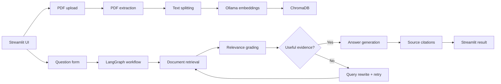

# Epilogue

Epilogue is a local, evidence-grounded research assistant built for technical PDF question answering. It uploads PDF documents, chunks their content, embeds the text with `nomic-embed-text` via Ollama, stores the vectors in ChromaDB, and answers questions through a LangGraph workflow that relies on retrieved evidence rather than the model's unaided memory.

## Overview

- Upload one or more PDFs
- Extract text and preserve page metadata
- Split content into overlapping chunks
- Embed chunks with Ollama using `nomic-embed-text`
- Store chunks in a persistent ChromaDB collection
- Retrieve and grade relevant passages
- Rewrite weak queries with bounded retries
- Generate grounded answers with source references
- Acknowledge when the available documents are insufficient

## Architecture



## Technology stack

- Python 3.11+
- Streamlit
- LangChain
- LangGraph
- ChromaDB
- Ollama with `qwen3:8b` and `nomic-embed-text`
- PyMuPDF

## Prerequisites

- Python 3.11 or later
- Ollama installed locally. Ollama is a separate application and is **not** installed by `pip install -r requirements.txt`.

Install Ollama for your operating system from the [official download page](https://ollama.com/download). After installation, open a new terminal and download the required embedding model plus one chat model:

```bash
ollama pull nomic-embed-text
ollama pull qwen3:8b
```

The `qwen3:8b` model is several gigabytes, so the first download may take a while. If your computer has limited memory or VRAM, pull a smaller chat model instead of `qwen3:8b`; see [Using a smaller model](#using-a-smaller-model) below. You only need one chat model. The embedding model is still required.

Check that your chosen chat model and the embedding model are installed with:

```bash
ollama list
```

Ollama normally starts its local service after installation. If it is not running, start it in a separate terminal with `ollama serve` and leave that terminal open while using the app.

## Installation

Clone the repository and create its Python virtual environment:

```bash
git clone https://github.com/anshukarthiks/epilogue.git
cd epilogue
python -m venv .venv
```

Activate the environment. On Windows PowerShell:

```powershell
.\.venv\Scripts\activate
```

On macOS or Linux:

```bash
source .venv/bin/activate
```

Then install the Python dependencies (with the environment activated):

```bash
python -m pip install --upgrade pip
python -m pip install -r requirements.txt
```

## Environment configuration

Optionally create a local `.env` file from `.env.example`. On Windows PowerShell:

```powershell
copy .env.example .env
```

On macOS or Linux:

```bash
cp .env.example .env
```

Relevant defaults:

```env
OLLAMA_BASE_URL=http://localhost:11434
OLLAMA_MODEL=qwen3:8b
OLLAMA_EMBEDDING_MODEL=nomic-embed-text
OLLAMA_NUM_CTX=4096
OLLAMA_NUM_PREDICT=512
CHROMA_PERSIST_DIRECTORY=data/chroma
CHROMA_COLLECTION_NAME=epilogue_documents
CHUNK_SIZE=1000
CHUNK_OVERLAP=150
RETRIEVAL_TOP_K=4
MAX_RETRIES=2
MAX_UPLOAD_SIZE=16777216
UPLOAD_DIRECTORY=data/uploads
```

The application reads these values from environment variables via `config.py`.
By default, Ollama automatically selects GPU offloading for chat and embeddings when
compatible hardware is available. Set `OLLAMA_NUM_GPU=0` to force CPU-only inference,
or set it to a positive GPU layer count to choose a specific offload amount. GPU use
may still be affected by CUDA/PTX compatibility with your installed drivers.
Chat reasoning is disabled and generation is bounded by `OLLAMA_NUM_PREDICT` to avoid
excessively long Qwen3 reasoning traces; increase that limit if longer answers are needed.

## Using a smaller model

The default `qwen3:8b` needs more memory than some computers have available. You can use a smaller Qwen3 model instead. For example, `qwen3:4b` is a good starting point; `qwen3:1.7b` is smaller still, but may produce less capable answers. Model file sizes are approximate, and Ollama also needs extra memory while generating answers.

For example, instead of downloading `qwen3:8b`, download `qwen3:4b`:

```bash
ollama pull qwen3:4b
```

Create `.env` from `.env.example` if you have not already, then change the chat model setting:

```env
OLLAMA_MODEL=qwen3:4b
```

Use `OLLAMA_MODEL=qwen3:1.7b` instead if you need a smaller model, and pull it with `ollama pull qwen3:1.7b`. If you still run into memory limits, lower `OLLAMA_NUM_CTX` in `.env` (for example, to `2048`); this reduces the amount of conversation/document context the model can handle at once.

## Running the application

With Ollama running, start Streamlit. On Windows PowerShell:

```powershell
.\.venv\Scripts\activate
streamlit run app.py
```

On macOS or Linux:

```bash
source .venv/bin/activate
streamlit run app.py
```

Then open:

```text
http://localhost:8501
```

## Uploading and querying PDFs

This repository intentionally ships with no pre-indexed PDFs.
When you launch the app, the collection starts empty and you upload the documents you want to query.

1. Open the home page.
2. Use the upload form to add one or more PDFs.
3. If the file is valid and contains extractable text, the app indexes it.
4. Ask a question in the form.
5. Review the answer and the source references.

The app will explain if the available evidence is insufficient and will not pretend unsupported facts are present.
The `data/uploads` and `data/chroma` folders are local-only working directories and are ignored by Git.

## ChromaDB persistence

The app uses a local persistent ChromaDB directory under `data/chroma` and a named collection called `epilogue_documents` by default. This means the vector database survives across restarts of the Streamlit application without needing a remote service.

ChromaDB fits this project well because it is easy to run locally, works with LangChain, keeps metadata alongside vectors, and avoids the complexity of an external database service for a prototype.

## LangGraph workflow

The graph follows this pattern:

`retrieve_documents -> grade_documents -> [generate_answer | rewrite_question] -> retrieve_documents ...`

The key idea is that retrieval is not treated as proof that the answer exists. The grader evaluates whether the chunks look relevant, and the workflow may rewrite the query and retry retrieval when the initial evidence is weak. The retry count is bounded to prevent infinite loops.

## Evaluation

A small example question set is provided in `data/evaluation/sample_questions.json` for local testing.
This file is for evaluation only; it does not preload any PDFs into the app.

You can evaluate retrieval quality by checking whether the returned passages overlap the expected passages for each question. The project includes a simple script at `scripts/evaluate_retrieval.py`.

Example:

```bash
python scripts/evaluate_retrieval.py
```

This kind of evaluation is intentionally lightweight: it helps check whether the retrieval pipeline selects relevant passages, but it does not prove model correctness or generalization.

## Known limitations

- The app is built for local development, not production deployment.
- The app relies on local Ollama services and therefore needs an available model runtime.
- Query rewriting and relevance grading are heuristic and cannot guarantee factual correctness.
- Some PDFs may not parse cleanly if they contain images, scanned pages, or very unusual layouts.

## Troubleshooting

If you see an Ollama-related error:

- Check that Ollama is running: `ollama serve`
- Check that the configured models are installed: `ollama list`
- Confirm that the model names in `.env` match the local installation
- Verify that the base URL is reachable at `http://localhost:11434`

If ChromaDB throws errors:

- Delete the stale local persistence directory if necessary
- Recreate the app and retry the upload

If upload or ingestion fails:

- Check that the file is a PDF
- Check that the file is under the configured upload size
- Review whether the PDF contains extractable text

## Future improvements

- Better question routing based on document metadata
- Better retrieval ranking and chunk re-ranking
- A richer answer UI with foldable source sections
- Manual document deletion or replacement
- A stronger evaluation harness with gold-standard answers
- Optional deployment via a production WSGI server

## Project structure

```text
app.py
config.py
requirements.txt
.env.example
.gitignore
README.md
rag/
  __init__.py
  ingestion.py
  retrieval.py
  graph.py
  prompts.py
  state.py
data/
  chroma/
  uploads/
  evaluation/
    sample_questions.json
scripts/
  evaluate_retrieval.py
```
